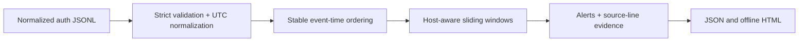

# Architecture / 架构

`ingest.py` validates the entire input before detection. Required string fields are `timestamp`, `event_type`, `source_ip`, `username`, `host`; empty values and control characters are rejected. Duplicate JSON keys and non-standard numeric constants are rejected. Additional fields are accepted but discarded. Blank lines are skipped while physical line numbers remain unchanged. UTF-8 BOM is accepted.

Times require ISO-8601 dates, seconds and explicit offsets; normalize to UTC. IPs normalize through Python `ipaddress`. Scoped IPv6 is not supported. Usernames and hosts are case-sensitive and retain exact spelling; adapters must define any case normalization themselves.

`engine.py` sorts events by timestamp, source name, then physical line number. Equal-time events therefore have deterministic file order, which is an ordering convention and not proof of real causality. Per-account groups are `(source_ip, username, host)`, and multi-account groups are `(source_ip, host)`. Hosts are isolated intentionally.

The window is inclusive: an event exactly 300 seconds before the current event remains eligible at default settings. Burst alerts fire when a threshold is crossed, stay suppressed while the group remains above the threshold, and re-arm once it falls below. Evidence is a snapshot at firing time rather than all subsequent burst traffic. A success with no new failure does not repeat the same success-after-failures finding.

`report.py` renders structured alerts. CLI hashes and parses the same input bytes, uses only the filename as report source, and embeds the configuration. For JSONL and OpenSSH input with an explicit year, no current wall-clock value is included, so the same bytes, filename and configuration give the same reports. Omitting the OpenSSH year uses the current UTC year and is therefore unsuitable for reproducible archive reports. A renamed file changes source identifiers and alert IDs. SHA-256 binds evidence to the analyzed input; it is not a digital signature or proof of trustworthy collection.

The OpenSSH adapter has two interfaces. `parse_openssh` preserves the original strict list-returning contract and raises on malformed authentication-looking input. `parse_openssh_result` is the accounting interface used by the CLI: it returns normalized events plus total, blank, unmatched and malformed-auth line counts and line-specific warnings. Publickey and `Invalid user` messages are included there. A malformed authentication line is excluded from detection and remains visible in the report, so a parser warning cannot be mistaken for a clean log.

The CLI reads the full file and the engine sorts it in memory; group state is retained for the current batch. This is a batch prototype. Memory limits, streaming and expired-key cleanup must be designed before use as a long-running service.

## Engineering decisions

`evaluation.py` validates a whole synthetic scenario dataset and runs the unchanged detector independently per scenario. It computes one binary decision for each (scenario, rule) pair and retains full raw alerts separately. `evaluation_report.py` renders a Markdown summary, escaping author-provided text as literal character entities. The dataset generator authors labels independently and never calls detection. See [evaluation methodology](evaluation.md) for metrics, evidence indexing and limits.

- Standard library first: make the initial experiment reproducible on an ordinary student laptop.
- A normalized event contract first: keep platform parsing separate from rule logic.
- Explainable thresholds first: build evaluation fixtures before experimenting with anomaly models.
- Offline reports first: preserve evidence and test safe rendering before adding a web service and its authentication surface.

## Trust boundaries

Only analyze logs you are authorized to use. Treat all log fields as untrusted text. HTML output escapes values and supplies a restrictive content policy. Reports may contain sensitive usernames/IPs from real input and should be handled with the same care as logs. This repository includes only synthetic fixtures; real collected logs belong in ignored `data/` and generated reports in ignored `output/`.
